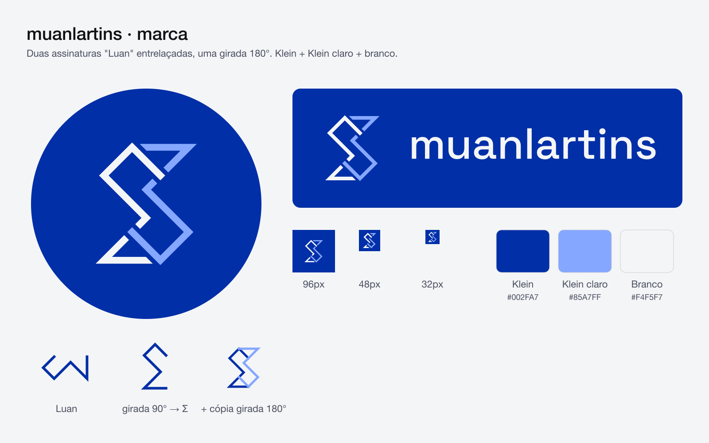

# muanlartins — brand



## The mark

The mark is my signature. "Luan" is written in one continuous stroke — L, U, A, N — and redrawn on a 45° lattice so every segment is either diagonal or vertical. Turned 90°, that stroke reads as a **Σ**: the sum, the first symbol you meet in statistics, which is what this project is about — measuring how you get better.

Two copies of it, one turned 180°, are glued together and woven over and under each other at the four points where they cross. The result is a point-symmetric **S** that, under the hood, is still just "Luan" twice.

- White copy over light-blue copy at two crossings, the reverse at the other two — the alternation is what keeps the 180° symmetry.
- Sharp miter corners and straight cuts at the crossings; no rounding.
- Both copies carry the same stroke weight. An optically compensated version (light-blue copy +7%) was tested in `explorations/v14-peso/` and rejected: the difference wasn't perceptible.

## Colors

| Name | Hex | Use |
|---|---|---|
| Klein | `#002FA7` | Ground. International Klein Blue. |
| Branco | `#F4F5F7` | Primary ink, the over copy. |
| Klein claro | `#85A7FF` | Accent, the under copy. Same hue and saturation as Klein (HSL 223° / 100%), lightness 76%. ~4.5:1 on Klein. |

The website extends this into a ramp of Klein tints (see `app/globals.css`).

## Typography

[Space Grotesk](https://fonts.google.com/specimen/Space+Grotesk) (SIL Open Font License, `fonts/OFL.txt`). The wordmark is `muanlartins`, lowercase, weight 500, outlined to paths so the SVGs render the same without the font installed.

## Files

| Path | What |
|---|---|
| `logo/mark.svg` | The mark, transparent background. |
| `logo/mark-on-klein.svg` | The mark on Klein. |
| `logo/avatar-800.png`, `logo/avatar-circle-800.png` | Profile pictures (square, and pre-cropped circle). |
| `logo/lockup.svg`, `logo/lockup-on-klein.svg`, `logo/lockup-on-klein-1600.png` | Mark + wordmark. |
| `small/mark-small.svg`, `small/mark-small-clear.svg`, `small/mark-{48,32}.png` | The small-size drawing: tighter crop, heavier stroke, wider gaps. Use it at 64px and below. |
| `small/favicon-16.svg`, `small/favicon-16.png` | 16px only: no weave, both copies white, pixel-snapped. |
| `small/favicon.ico` | 16 + 32 + 48 in one file. |
| `og/og-1200x630.png` | Social preview card (link previews on WhatsApp, X, LinkedIn…). |
| `youtube/profile-800.png` | YouTube profile picture (YouTube crops it to a circle). |
| `youtube/watermark-150.png` | Video watermark: the small drawing, on Klein so it reads over any footage. |
| `youtube/banner-2560x1440.png` | YouTube banner: the lockup on the mark's 45° lattice, lined up with its strokes. `banner-crops.png` shows what TVs, desktops and phones keep. |
| `youtube/thumbnails/<topic>.png` | Video thumbnails (1280×720): the topic's rank and the series' name over its title, on the lattice, with the rank's emblem glowing in its colour on the right. One per entry in `THUMBNAILS` in `build.py`, named after the topic's id on the site. |
| `youtube/thumbnails/ranks/<rank>.png` | The in-game emblem of each rank's division I (Psyonix's art, from `github.com/manucabral/rocket-league-rank-viewer`), for the thumbnails. It sits next to them because `rsvg-convert` only loads images from the SVG's folder or below. |
| `twitch/profile-800.png`, `twitch/banner-1200x480.png`, `twitch/offline-1920x1080.png` | Twitch profile picture, profile banner and the player's offline image. Twitch shows the banner behind the player, so it is only the lattice; accent colour is Klein. |
| `webcam/webcam-{left,right}-{1920x1080,3840x2160}.png` | Webcam background: the banner's look with the lockup in a top corner, and the lattice faded out where you sit. Pick the side your head isn't on. |
| `twitch/obs.py`, `twitch/transicao.mjs` | The stream's OBS scene collection and the renderer of its transition. See "Stream" below. |
| `brand-board.png` | Everything above on one page. |
| `explorations/` | How it got here — see its README. |

## Stream

The overlays for OBS are web pages in `public/stream/`, served with the site at `muanlartins.com.br/stream/`, so OBS loads them by URL and a release updates them. They're laid out at 1920×1080 and scale themselves to the browser source's size (the OBS canvas is 2560×1440). Pixel positions below are in 1920×1080; on the canvas, multiply by 4/3.

| Page | Scene | What |
|---|---|---|
| `jogo.html` | Jogo, Jogo + chat | Transparent; the camera frame, 480×270 at (44, 740), bottom left, clear of the boost meter and the scoreboard. `?lado=direita` and `?altura=cima` move it to (1396, 740) or (44, 44). `?chat=1` adds the chat on the other side, 420×640 at (1456, 96), above the boost meter; there messages leave after 45 s. |
| `conversa.html` | Conversa | The camera large, 1280×720 at (64, 64), the chat down the right and a line under the camera (`?topico=`, with `?rotulo=` for the label above it, "Agora" by default). |
| `intervalo.html` | Começando, Já volto, Fim | `?tela=comecando` (default; `?minutos=5` counts down), `?tela=volto`, `?tela=fim`. `?titulo=` and `?rotulo=` replace the headline and the label above it, `?chat=0` hides the chat. |
| `transicao.html` → `transicao.webm` | Transition | The stinger. OBS plays stingers from video files only, so `twitch/transicao.mjs` renders the page frame by frame into a VP9 WebM with transparency. Transition point: 600 ms. |

The camera frame is a Klein band with its top-left and bottom-right corners cut at 45° (the mark's 180° symmetry), lined with the lattice. Two streaks, Branco and Klein claro, the mark's two copies, run around it half a lap apart. A name plate with the small mark and `muanlartins.com.br` sits on its bottom edge. Every 5 s, in turn, something moves to catch the eye: the plate's line wipes out and back in, or a sheen crosses the band at 45°, from one cut corner to the other. On the Klein ground of `conversa.html` the band is navy, to read as a frame.

The chat is Twitch's, read anonymously over IRC (`?canal=`, default `muanlartins`), with emotes, without commands (`!…`) or bots, and with moderation deletes applied. `?demo` fills it with sample messages, to set scenes up offline.

The transition: two Klein panels close in from opposite corners along the lattice, one turned 180° from the other, each led by a streak of its copy's colour that stretches with its speed. The screen is covered while the mark draws itself, then the panels pull back into the centre line and take the mark with them.

To set OBS up, import the scene collection (Scene Collection → Import):

```bash
python3 brand/twitch/obs.py "C:/Users/muanl/Documents/muanlartins-obs/transicao.webm" > muanlartins.json
```

The argument is where `transicao.webm` sits on the streaming machine. The canvas size and the devices (camera, microphone, Rocket League's window) are constants at the top of `obs.py`. To re-render the transition after changing the page: `CHROME=/path/to/chrome node brand/twitch/transicao.mjs` (needs ffmpeg and `playwright-core`).

## Rules of thumb

- At 64px and below, use the `small/` drawing; at 16px, the favicon.
- Keep the mark on Klein or on a transparent background over Klein. On anything else, it needs the Klein ground behind it.
- Don't recolor the copies, round the corners, or rotate the mark — the 180° symmetry is the point.

## Regenerating

`build.py` is the source of truth: every file above, and the website's icons (`app/icon.svg`, `app/favicon.ico`, `app/apple-icon.png`, `app/opengraph-image.png`, `public/brand/`), comes out of it.

```bash
cd brand
python3 -m venv .venv && ./.venv/bin/pip install -r requirements.txt   # once
./.venv/bin/python build.py
```

Needs `rsvg-convert` (librsvg) and ImageMagick (`magick`): `brew install librsvg imagemagick`.
