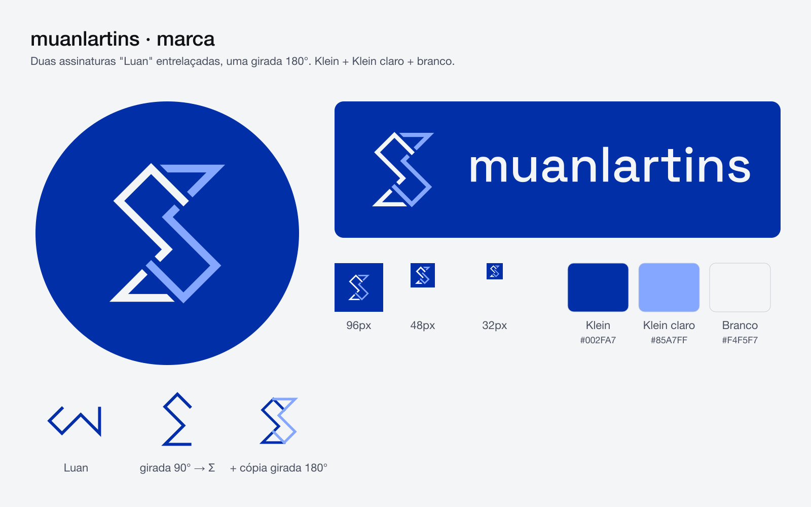

# muanlartins — brand



## The mark

The mark is my signature. "Luan" is written in one continuous stroke — L, U, A, N — and redrawn on a 45° lattice so every segment is either diagonal or vertical. Turned 90°, that stroke reads as a **Σ**: the sum, the first symbol you meet in statistics, which is what this project is about — measuring how you get better.

Two copies of it, one turned 180°, are glued together and woven over and under each other at the four points where they cross. The result is a point-symmetric **S** that, under the hood, is still just "Luan" twice.

- White copy over light-blue copy at two crossings, the reverse at the other two — the alternation is what keeps the 180° symmetry.
- Sharp miter corners and straight cuts at the crossings; no rounding.
- Both copies carry the same stroke weight. An optically compensated version (light-blue copy +7%) was tested in `explorations/v14-peso/` and rejected: the difference wasn't perceptible.

## Colors

| Name | Hex | Use |
|---|---|---|
| Klein | `#002FA7` | Ground. International Klein Blue. |
| Branco | `#F4F5F7` | Primary ink, the over copy. |
| Klein claro | `#85A7FF` | Accent, the under copy. Same hue and saturation as Klein (HSL 223° / 100%), lightness 76%. ~4.5:1 on Klein. |
| Vitória | `#007645` | Wins on the site's ranked records (`--color-win`). |
| Derrota | `#B53031` | Losses (`--color-loss`). The pair has the same lightness and chroma in OKLCH (0.50–0.52), so neither shouts over the other, and both carry white text at 5.7:1 and 6.1:1. |

The website extends this into a ramp of Klein tints (see `app/globals.css`).

## Typography

[Space Grotesk](https://fonts.google.com/specimen/Space+Grotesk) (SIL Open Font License, `fonts/OFL.txt`). The wordmark is `muanlartins`, lowercase, weight 500, outlined to paths so the SVGs render the same without the font installed.

## Files

| Path | What |
|---|---|
| `logo/mark.svg` | The mark, transparent background. |
| `logo/mark-on-klein.svg` | The mark on Klein. |
| `logo/avatar-800.png`, `logo/avatar-circle-800.png` | Profile pictures (square, and pre-cropped circle). |
| `logo/lockup.svg`, `logo/lockup-on-klein.svg`, `logo/lockup-on-klein-1600.png` | Mark + wordmark. |
| `small/mark-small.svg`, `small/mark-small-clear.svg`, `small/mark-{48,32}.png` | The small-size drawing: tighter crop, heavier stroke, wider gaps. Use it at 64px and below. |
| `small/favicon-16.svg`, `small/favicon-16.png` | 16px only: no weave, both copies white, pixel-snapped. |
| `small/favicon.ico` | 16 + 32 + 48 in one file. |
| `og/og-1200x630.png` | Social preview card (link previews on WhatsApp, X, LinkedIn…). |
| `youtube/profile-800.png` | YouTube profile picture (YouTube crops it to a circle). |
| `youtube/watermark-150.png` | Video watermark: the small drawing, on Klein so it reads over any footage. |
| `youtube/banner-2560x1440.png` | YouTube banner: the lockup on the mark's 45° lattice, lined up with its strokes. `banner-crops.png` shows what TVs, desktops and phones keep. |
| `youtube/thumbnails/<topic>.png` | Video thumbnails (1280×720): the topic's rank and the series' name over its title, on the lattice, with the rank's emblem glowing in its colour on the right. One per entry in `THUMBNAILS` in `build.py`, named after the topic's id on the site. |
| `youtube/thumbnails/2v2-<episode>.png` | 2v2 comentado thumbnails (1280×720): the same frame around a giant "2v2", both 2s in Branco, with the episode's number on a Branco plate cut at 45° like the stream's camera frame. The rank and tier are where the episode was played. One per entry in `EPISODES` in `build.py`. |
| `youtube/thumbnails/live-<date>.png` | The plain thumbnail of each Twitch live's VOD (1280×720): the same plate layout around a giant "Live" in Branco, with the day on the plate. A live that climbed shows the rank and tier it reached. One per entry in `LIVES` in `build.py`. Since the lives went public (2026-11-12) it's only the fallback. |
| `youtube/thumbnails/live-<date>.jpg` | The live's thumbnail made to be clicked, by `scripts/thumb.py` (not `build.py`): Luan cut out from the camera (a frame he picked), big on the right with a Branco outline, over the game blurred past reading any name and darkened to Klein on the left, a hook of 2 to 4 words in Space Grotesk Bold (the second line on the Branco plate cut at 45°), the rank's emblem when it climbed, and "AO VIVO · dd/mm" on a Klein plate. JPEG, since YouTube takes 2 MB at most. |
| `youtube/thumbnails/ranks/<rank>.png` | The in-game emblem of each rank's tier I, and `<rank>-<tier>.png` for the other tiers the 2v2 episodes and lives need (Psyonix's art, from `github.com/manucabral/rocket-league-rank-viewer`), for the thumbnails. It sits next to them because `rsvg-convert` only loads images from the SVG's folder or below. |
| `twitch/profile-800.png`, `twitch/banner-1200x480.png`, `twitch/offline-1920x1080.png` | Twitch profile picture, profile banner and the player's offline image. Twitch shows the banner behind the player, so it is only the lattice; accent colour is Klein. |
| `twitch/paineis/<panel>.png` | The channel's panels under the player (640 px wide, Twitch shows them at 320): the small mark and the panel's name on Klein, on the lattice, cut like the camera frame. `pix.png` adds the Pix QR code on a Branco plate; it holds the Pix key, so `build.py` draws it only when `PIX_BRCODE` (the bank's "copia e cola" text) is set, and git ignores it. |
| `twitch/emotes/<Nome>-{1024,112,56,28}.png`, `<Nome>.svg` | The Twitch emotes (code `muanla<Nome>`): a Klein badge cut like the camera frame, so they read on Twitch's dark and light chat, with a pictogram or a word in Branco and Klein claro. Tier 1 Logo, Gol, Bug, Pix (a coin with R$, not the Pix logo), Hipotese (a test tube); tier 2 Torcida (the stand's fans); tier 3 Diamante; followers Oi (a fan waving) and GG. `Logo-animado` (the mark drawing itself) and `Gol-animado` (flashing) are GIFs at 112, 56 and 28. `python build.py emotes` redraws only these. |
| `twitch/selos/<MM>-meses-{72,36,18}.png`, `<MM>-meses.svg`, `folha.png` | The sub badges, by months: the emotes' Klein badge cut like the camera frame. The first year counts in stripes on the lattice's 45°, parallel to the cuts (1, 2 and 3 months in Klein claro, brightening to Branco at 6 and 9); a year is the mark in its thick favicon drawing (the woven one blurs at 18 px), on Klein at 12, framed in Klein claro at 18, turned over to Branco with a Klein frame at 24. `folha.png` shows them on Twitch's dark and light chat. `python build.py selos` redraws only these. |
| `twitch/alertas/alerta.{html,css}` | The stream's follow and raid alerts, pasted into Twitch's Alerts Box (custom HTML/CSS). See "Stream" below. |
| `webcam/webcam-{left,right}-{1920x1080,3840x2160}.png` | Webcam background: the banner's look with the lockup in a top corner, and the lattice faded out where you sit. Pick the side your head isn't on. |
| `twitch/obs.py`, `twitch/transicao.mjs` | The stream's OBS scene collection and the renderer of its transition. See "Stream" below. |
| `brand-board.png` | Everything above on one page. |
| `explorations/` | How it got here — see its README. |

## Stream

The overlays for OBS are web pages in `public/stream/`, served with the site at `muanlartins.com.br/stream/`, so OBS loads them by URL and a release updates them. They're laid out at 1920×1080 and scale themselves to the browser source's size. Pixel positions below are in 1920×1080, the size of the OBS canvas and of the stream.

| Page | Scene | What |
|---|---|---|
| `jogo.html` | RL + chat; Valorant + chat | Transparent; the camera frame, 480×270 at (44, 740), bottom left, clear of the boost meter and the scoreboard. `?lado=direita` and `?altura=cima` move it to (1396, 740) or (44, 44). `?chat=1` adds the chat on the other side, 420×640 at (1456, 96), above the boost meter; there messages leave after 45 s, on a translucent navy pane as tall as they are. In Valorant's scenes ("Overlay · Valorant" and "Overlay · Valorant + chat", with `?jogo=valorant&altura=cima`: the camera sits at (44, 44), over the minimap, Luan's choice), the same plate is filled from `scripts/valorant.py` instead: Luan's Valorant rank and emblem, the queue and the map, and the day's competitive record, or the score while a match is on; and the chat starts under the killfeed, 420×420 at (1456, 340). |
| `torcida.html` | RL + chat, over `jogo.html` | The crowd: a stand at the bottom centre (596 to 1556), between the camera and the boost meter, with a fan for each viewer logged in to the chat, their name over them, ten to a row like bleachers (four rows), the channel and then who has the most Σ in front (`sigma.js`), each name after its Rocket League rank's emblem; no count. Each fan's look comes from their profile on the site (`/perfil`: colours, head, outfit, accessory, celebration, an arrival shout and stickers, drawn by `torcedor.js`), or, until they make one, from their login. On our goal each does their own celebration and throws their stickers (their goal too); someone who just arrived shouts their phrase in a balloon. It reacts to what `partidas.html` sends: our goal is a wave, confetti, "GOOOL!" with the speed and a goal dedicated to someone drawn from the stand (weighed by Σ, flattened); theirs, a slump; our saves, a cheer ("DEFESAÇA!" on an epic one). In Valorant (`?jogo=valorant`, the source "Torcida · Valorant" in Valorant's scenes, same key and track), `scripts/valorant.py` sends each round's result and the match's end instead: a round won is a smaller party with "ROUND!" and the score, a round lost a slump, a match won the full party with "VITÓRIA!" and the win dedicated (narrated, like a lost match's end); and since Valorant's abilities sit at the bottom centre, the stand tucks under the screen's edge while a match is played and comes up for each round's end and between matches. What a viewer says in the chat shows for 5 s in a balloon over the stand pointing at their fan, whose name lights up (three at once at most, 80 characters). Viewers move their own fan from the chat: `!pula`, `!danca`, `!ola`. While "Galvão narrando os gols" is on in `partidas.html` (off by default: it tires), goals are narrated in the narrator's voice by `scripts/narrador.py` (the opener at once, then the speed and the dedication). OBS sends the source's sound to track 5, "Live", which is what the stream carries (everything plus the narrator) and isn't recorded, so the VOD on YouTube never has it; Luan hears it through monitoring. While the stream is on (the dock says so), it tells the Σ API who's in the chat once a minute, which is how viewers earn Σ; the key is in OBS's source URL only (`#chave=`). Empty, it invites: "Entre no chat e apareça aqui". `?demo` fills it and plays moments; keys in the page's comment. |
| `pix.html` | The game scenes (both games'), over everything; Conversa, cropped to the band on the camera's lower third (one source in all of them, so an alert never plays twice) | The Pix sent on the site's `/pix`: the Twitch alerts' band (Klein, cut corners, the lattice, a sheen) under the scoreboard with the amount, the name and the message, a chime, then the message in the viewer's chosen voice (or their recording, in that voice) from `scripts/narrador.py`. A Pix marked "entre partidas" waits for the match to end (`partidas.html` says when). At the top left, always, the call: a QR code to `/pix` (`pix-qr.svg`, from `scripts/pix-qr.mjs`) with "Pix com voz" (`?chamada=0` leaves it out; `conversa.html` shows a bigger one under the camera, on the right); a goal, when the dock sets one, is a small bar under it. In Valorant's scenes, where the camera takes the top left, the page moves the call and the goal down to y 380, under the camera's plate (it knows the scene by name; `?canto=baixo` forces it). Sound on track 5 only, like the narrator. `?api=` the Pix API, `#chave=` the Σ key; `?demo` plays made-up ones. |
| `conversa.html` | Conversa | The camera large, 1280×720 at (64, 64), the chat down the right and a line under the camera (`?topico=`, with `?rotulo=` for the label above it, "Agora" by default). |
| `creditos.html` | Fim (above the camera, "Tela · Créditos", restarts on each entry) | The end of the live as a film's: the camera where Conversa has it, the credits rolling up the right-hand column (55 px/s, `?velocidade=`) after the title holds `?espera=` 4 s, and under the camera the stand with everyone who watched today (twelve to a row, four rows, who watched longest in front) on the plate "A torcida de hoje · N". As a name rolls past the middle of the column, its fan in the stand does their own celebration, name lit. The sections, each only when it has someone: Estrelando (the channel), the day's score (Rocket League from Partidas' `muanlartins-partidas`, Valorant from `jogo.html`'s day in this site's storage), goals and wins dedicated (`torcida.html` keeps them, on air, in the same storage: OBS's browser sources share it), raids, follows, subs, gifted subs and bits (the Efeitos dock signed in to Twitch sends the day as `muanlartins-creditos`), Pix (the mural's, today), first time here (`primeira` in the Σ API), everyone in the stand with their time today and run of lives (the Σ API's `GET /live`), the next live (the agenda, the profile API's `GET /agenda`), and the closing card with the mark, which stays. The chat still talks over the fans, and who comes into the chat joins. Copy is a draft. `?demo` fills it with sample people. |
| `intervalo.html` | Começando, Já volto (Fim until 2026-11-10) | `?tela=comecando` (default; `?minutos=5` counts down), `?tela=volto`, `?tela=fim`. `?titulo=` and `?rotulo=` replace the headline and the label above it, `?chat=0` hides the chat. |
| `partidas.html` | Custom browser dock, off stream | The ranked matches, read from Rocket League's own Stats API (`PacketSendRate` above 0 in the game's `TAGame\Config\DefaultStatsAPI.ini`; a big game update can reset it). It counts each session's wins and losses per mode, keeps the rank (set by hand: the game doesn't tell it; after a ranked match the points field lights up and takes the total or the gain, +9) and sends both to `jogo.html` through obs-websocket, where a plate on the frame's top edge shows them; goals and our saves go to `torcida.html` the same way. It also logs each match's events and when the stream and the recording start, and cuts to Conversa when a match ends and back when the next one loads. "Publicar" writes each session to `content/matches/` with a GitHub token, without other players' names. A Valorant tab does the same for Valorant with nothing typed: `scripts/valorant.py` gives the rank and RR from the game and each match's summary from its history a little after it ends (score, map, agent, K/D/A, ACS, HS%, RR), published to `content/valorant/` by the same button; the tab follows whichever game is open, the stream's and recording's times go to that game's session, and a Valorant match's end cuts to Conversa, agent select back to the Valorant scene ("Valorant" or "Valorant + chat"). |
| `pix-painel.html` | Custom browser dock, off stream | The Pix: those that arrived without a form (placed on a reservation, shown as Anônimo, or ignored; nothing goes on screen by itself), registering one by hand, the latest with "Repetir" and "Tirar do mural", and the goal. Same `?api=` and `#chave=` as `pix.html`. |
| `presenca.html` | Custom browser dock, off stream | Who is in the chat now and who just came or left, from Twitch's IRC membership events, with a soft tone on arrivals (`?som=0` mutes it) and "primeira vez" on a first visit. Only viewers logged in with the chat open show, about 10 s late; the usual bots are left out. |
| `lance.html` | Lance ruim and Lance ruim · Valorant, on top | The bad play's shock, as in anime: a flash, then black speed lines rushing in from the edges toward the middle, redrawn a dozen times a second so they shiver, the face left clear. No words. Restarts when the scene goes live; the scene is the game's with the camera on top, which the Efeitos dock zooms to the whole screen and back after 4 s, then returns to the scene before. Each game has its own Lance ruim scene (its capture, its camera position); F2 and the dock's button pick the one of the game last on screen. It's only ever fired by hand (Luan, 2026-11-08). Its sting, "dun dun duuun", is the scene's media source "Som · Lance ruim", restarted on activation. |
| `var.html` | VAR · Rocket League and VAR · Valorant, over the camera, under the crowd; and RL + chat and Valorant + chat, over the overlays (the mini player) | The video referee's booth, opened by hand from the Efeitos dock (F8). It plays the clip itself (the game alone, from Source Record's replay buffer, served by `scripts/replay.py`), in one of two layouts the dock picks: the booth, the Klein ground everywhere but the camera's hole, 512×288 at (1344, 136), with the clip in the monitor, 1216×684 at (64, 136), each in the camera frame with a referee-yellow tab ("REPLAY" with its speed, "CÂMERA LENTA" in the slow motion, "AO VIVO"); or the mini player, 640×360 at (1236, 92) over the game, top right, with the vote under it where the chat is (`jogo.html` fades its chat meanwhile). Under the clip, its progress. An instant replay (the clip's last seconds, no looking for the play, Luan's call on 2026-11-12) that plays on its own: the stretch once at full speed, again at 50% (Valorant zooms on the crosshair meanwhile), and for the vote's last 8 s a closing screen ("FIM DO REPLAY · Últimos votos" and the seconds) over the clip frozen on its last frame. Muted. A band across the top ("VAR · Revisão do lance"); under the camera, the chat's vote: the question, each option with its command (`!1`, `!2`, `!3`), its count and bar, and the clock. As each VAR opens, the monitor's frame draws itself, two strokes from the top's middle meeting at the bottom: the referee drawing the screen in the air. A line dragged in the dock crosses the whole replay in yellow, like TV's offside line. On a tie the tied options pulse ("Empate: sorteio") and a draw settles it 2.5 s later; on the verdict, the winning option lands on a yellow card slammed over the monitor. Meanwhile `torcida.html` dresses everyone in referee kit (yellow shirt, black collar, a whistle), each voter raises a card with their number, and on the verdict who got it right celebrates (and gets 3 Σ) while the rest slump. The chat's verdict is final, a tie is drawn at random (2026-11-12; Luan can still pick in the dock first). Copy is a draft. `?demo` plays one (`&voto=` its seconds); `?demo=votacao`, `empate`, `veredito`, `mini`, `fim` hold a frame (`&replay=` a clip's URL, `&fundo=` a game screenshot behind). |
| `terapia.html` | Terapia | A breather: water in the channel's blues (waves, light drifting at 45°), "Respira." and a breathing guide (a ring that fills for 4 s, holds 4, empties for 6: "Inspira…", "Segura…", "Solta…"), the camera small in its frame at (64, 64), 560×315, and the chat down the right. Its music is made by the page as it plays (long chords on D, bells from its pentatonic scale, a soft breath that follows the guide), so it has no rights to clear and goes to every track; it restarts on each entry and stops off screen. `?mudo` silences it. |
| `efeitos.html` | Custom browser dock, off stream | Also the day on Twitch for the credits (follows, subs, gifts, bits, raids, heard over EventSub with the same sign-in and kept per day; a token from before 2026-11-10 lacks the scopes and asks to connect again), sent to `creditos.html` every 5 s and as Fim goes on air. The effects: "Lance ruim" (F2), "Terapia" (F3) and back to the scene before (F4, faded: from an effect the scene it came from, from Conversa or Já volto the last scene before it, nothing in a game scene; the dock shows where it would go), Lance ruim each game's own, read from the scene on screen (F2 and F4 are triggers, "Gatilho · …", like the sounds', so the dock picks the scene), the VAR (F8: saves the Replay Buffer, which the dock starts with the stream or the recording; in Valorant it opens at once, in Rocket League it's a mark to open from the dock after the match (× deletes one from the list, the clip stays); then it counts the chat's `!1`–`!3`, 30 s or 20 s, waits for Luan on a tie (a line says whether the chat is connected and what became of the last vote: Luan's own never counts), holds the verdict 7 s and goes back; the replay can start over, run at 50% or 25% or pause, and a line dragged on its picture shows on stream; F4 closes it), and the sounds; also the channel points' rewards Palmas, Uuuh and Tambor (the sounds only), which it creates, pauses off the air and plays (signed in to Twitch from the dock; it refunds what can't play). It animates the camera through obs-websocket, so keep it docked where it's visible. `#obs=` the websocket password. |
| `tocador.html` + `sons/*.wav` | Browser source "Sons", in the game and talk scenes | Plays the sound effects when the Efeitos dock says so: palmas (F5), uuuh (F6), tambor (F7), the bad play's sting and the VAR's whistle (as it opens and on the verdict). Each hotkey restarts a trigger, a media source "Som · …" playing a silent file (OBS plays every media source once when it loads, so sounds kept there all went off at once), and the dock, hearing it, has this page play the sound. Without the dock open they're silent. All at -16 LUFS. `palmas.wav` is "277021 sandermotions applause-2" from Wikimedia Commons (CC0), cut to 5.6 s with fades; the rest are synthesized by `sons.js` (no samples, so they may go into the VOD) and rendered by `brand/twitch/sons.mjs`. `brand/twitch/sons/` keeps the first takes, including the ones Luan dropped (buzina, suspense, ba-dum-tss, boing). |
| `transicao.html` → `transicao.webm` | Transition | The stinger. OBS plays stingers from video files only, so `twitch/transicao.mjs` renders the page frame by frame into a VP9 WebM with transparency. Transition point: 600 ms. |
| `transicao-var.html` → `transicao-var.webm` | Transition "VAR", the VAR scenes' override in and out (the dock sets it) | The same panels led by yellow and Branco streaks; in the middle, the referee's screen drawn in the air and "VAR" landing in it. `node twitch/transicao.mjs 2560 transicao-var`. |

The camera frame is a Klein band with its top-left and bottom-right corners cut at 45° (the mark's 180° symmetry), lined with the lattice. Two streaks, Branco and Klein claro, the mark's two copies, run around it half a lap apart. A name plate with the small mark and `muanlartins.com.br` sits on its bottom edge. Every 5 s, in turn, something moves to catch the eye: the plate's line wipes out and back in, or a sheen crosses the band at 45°, from one cut corner to the other. On the Klein ground of `conversa.html` the band is navy, to read as a frame.

The chat is Twitch's, read anonymously over IRC (`?canal=`, default `muanlartins`). It opens with the last 20 messages, from `recent-messages.robotty.de` (Twitch's IRC keeps no history), so reloading a source doesn't empty it. It shows emotes, without commands (`!…`) or bots, and with moderation deletes applied. `?demo` fills it with sample messages, to set scenes up offline.

The transition: two Klein panels close in from opposite corners along the lattice, one turned 180° from the other, each led by a streak of its copy's colour that stretches with its speed. The screen is covered while the mark draws itself, then the panels pull back into the centre line and take the mark with them.

The alerts are Twitch's own (Creator Dashboard → Alerts, "Alerts Box 1"), not a page here: Twitch knows the events, and mods can replay or skip an alert from the activity feed. Each variant runs `twitch/alertas/alerta.html` and `alerta.css` in custom HTML/CSS mode, with `{rotulo}` replaced by its label ("Novo seguidor"; "Raid · {amount} chegando"), for 7 s. It's a Klein band like the camera frame that wipes in along the diagonal while a sheen crosses it, the mark and a Klein claro label over the name. Twitch strips `@import` and scripts, so the font is an `@font-face` from Google Fonts. Subs, gifts and bits still use Twitch's default look, as the channel can't receive them before Affiliate.

To set OBS up, import the scene collection (Scene Collection → Import):

```bash
python3 brand/twitch/obs.py "C:/Users/muanl/Documents/muanlartins-obs/transicao.webm" "<Alerts Box URL>" > muanlartins.json
```

To add only what's new to the collection OBS already has (keeping its secrets), close OBS and run `python3 brand/twitch/obs.py --apply` (`--dry-run` first lists what it would add): new sources, scenes and items, transitions and unbound hotkeys, the sounds, and the Efeitos dock. It changes nothing else, but for the hotkeys it retires (`RETIRED`: F2 and F4 moved from the scenes to the dock's triggers on 2026-11-08).

The first argument is where `transicao.webm` sits on the streaming machine; the second, the Alerts Box's browser source URL (Alerts → Copy, kept out of the repo since it carries a token), adds it as "Alertas", 1100×200, centred under the scoreboard in the game scenes and under the camera in Conversa. The canvas size and the devices (camera, microphone, Rocket League's and Valorant's windows) are constants at the top of `obs.py`. Valorant's scenes ("Valorant", "Valorant + chat", "Lance ruim · Valorant") are Rocket League's with their own capture ("Captura · Valorant", which also records "… jogo.mkv"), overlays and crowd, and the camera at the top left.

The sound is split so each part has its own fader and its own track in recordings: track 1 has everything, 2 the microphone, 3 the game. The game's sound comes with its capture; Discord and the browser are captured app by app, since desktop audio would carry the game a second time. The microphone goes through NVIDIA Broadcast for noise, then a compressor and a limiter. The alerts play through OBS and the headphones. To re-render the transition after changing the page: `CHROME=/path/to/chrome node brand/twitch/transicao.mjs` (needs ffmpeg and `playwright-core`).

## Rules of thumb

- At 64px and below, use the `small/` drawing; at 16px, the favicon.
- Keep the mark on Klein or on a transparent background over Klein. On anything else, it needs the Klein ground behind it.
- Don't recolor the copies, round the corners, or rotate the mark — the 180° symmetry is the point.

## Regenerating

`build.py` is the source of truth: every file above, and the website's icons (`app/icon.svg`, `app/favicon.ico`, `app/apple-icon.png`, `app/opengraph-image.png`, `public/brand/`), comes out of it.

```bash
cd brand
python3 -m venv .venv && ./.venv/bin/pip install -r requirements.txt   # once
./.venv/bin/python build.py
```

Needs `rsvg-convert` (librsvg) and ImageMagick (`magick`): `brew install librsvg imagemagick`.
